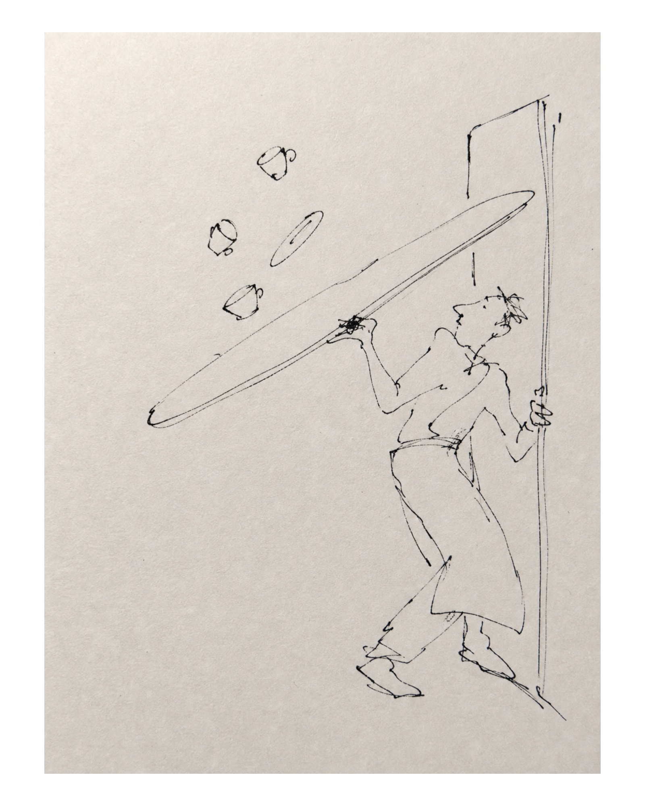
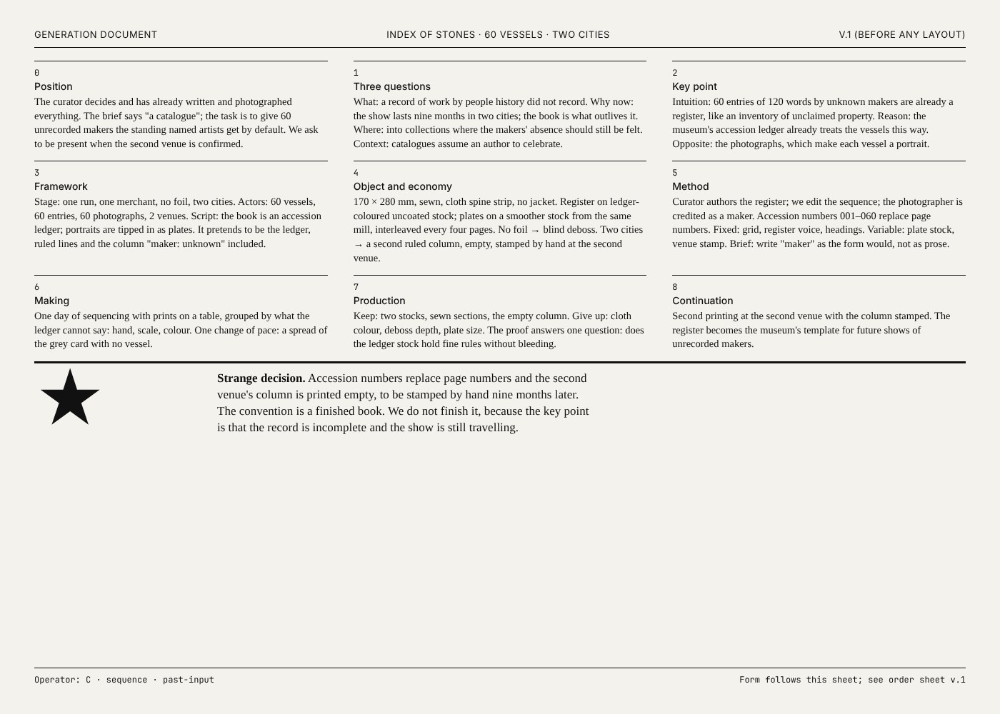

# LabArt

Black-pen illustrations, animated pixel art, deadpan watercolor illustrations, and a type-led design method. Explore each plugin below.

## Antibes Holiday

Draw relaxed black-pen illustrations, narrative scenes, and expressive marks from a concept or reference.

<table>
  <tr>
    <td width="50%"><a href="docs/antibes-holiday/README.md"></a></td>
    <td width="50%"><a href="docs/antibes-holiday/README.md"></a></td>
  </tr>
</table>

[Explore Antibes Holiday →](docs/antibes-holiday/README.md)

## Tephra

Redraw images as moving pixel particles or dithered solids with fracture streaks. Export stills and looping animations.

<table>
  <tr>
    <td width="50%"><a href="docs/tephra/README.md"></a></td>
    <td width="50%"><a href="docs/tephra/README.md"></a></td>
  </tr>
</table>

[Explore Tephra →](docs/tephra/README.md)

## Deadpan Doodles · 沙冰

Translucent pen and watercolor, offbeat proportions, and a straight face.
Draw portraits, animals, plants, objects, and quietly absurd little scenes.

<table>
  <tr>
    <td width="33%"><a href="docs/deadpan-doodles/README.md"></a></td>
    <td width="33%"><a href="docs/deadpan-doodles/README.md"></a></td>
    <td width="33%"><a href="docs/deadpan-doodles/README.md"></a></td>
  </tr>
</table>

[Explore Deadpan Doodles →](docs/deadpan-doodles/README.md) · [中文介绍](docs/deadpan-doodles/README.zh-CN.md)

## OK-RM Design · 有意义的秩序

Take a project from zero to one: write the generation document first (position, question, key
point, framework, object, method, making, production, continuation) and one strange decision that
follows from the content; then the form, in ubiquitous visual languages.
For books, magazines, posters, identities, exhibitions, brand projects, websites and interfaces.

<table>
  <tr>
    <td width="50%"><a href="docs/okrm-design/README.md"></a></td>
    <td width="50%"><a href="docs/okrm-design/README.md"></a></td>
  </tr>
</table>

[Explore OK-RM Design →](docs/okrm-design/README.md) · [中文介绍](docs/okrm-design/README.zh-CN.md)

## Marketplace

```text
codex plugin marketplace add haorantang97/LabArt --ref main
```

Each marketplace source points to `plugins/<name>/`. For standalone Skill installation,
select only `plugins/<name>/skills/<name>/`; this directory contains its runtime
instructions, resources, UI metadata, and license. Plugin-level screenshots are
used by the marketplace interface. Repository introductions, design records, and
development tests live outside the plugin packages.

After a new release, refresh the marketplace and install the desired plugin version:

```sh
codex plugin marketplace upgrade labart
codex plugin add deadpan-doodles@labart
```

Replace `deadpan-doodles` with the plugin you use. Check the reported version and
start a new task to load it. A marketplace refresh alone does not establish that
an already installed plugin was updated.

[Package checks](docs/VALIDATION.md) · [Changelog](CHANGELOG.md) · [License](LICENSE)
