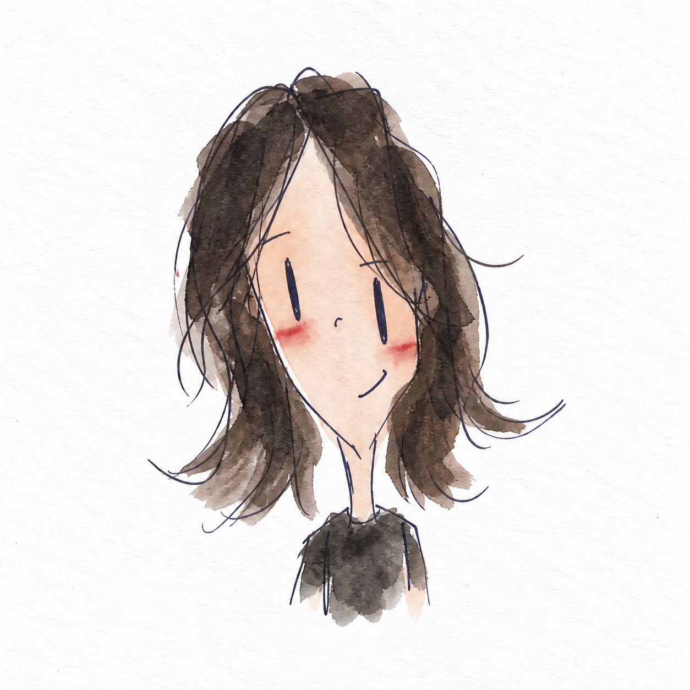

# LabArt

Black-pen illustrations, animated pixel art, and deadpan watercolor illustrations. Explore each plugin below.

## Antibes Holiday

Draw relaxed black-pen illustrations, narrative scenes, and expressive marks from a concept or reference.

<table>
  <tr>
    <td width="50%"><a href="plugins/antibes-holiday/README.md"></a></td>
    <td width="50%"><a href="plugins/antibes-holiday/README.md"></a></td>
  </tr>
</table>

[Explore Antibes Holiday →](plugins/antibes-holiday/README.md)

## Tephra

Redraw images as moving pixel particles or dithered solids with fracture streaks. Export stills and looping animations.

<table>
  <tr>
    <td width="50%"><a href="plugins/tephra/README.md"></a></td>
    <td width="50%"><a href="plugins/tephra/README.md"></a></td>
  </tr>
</table>

[Explore Tephra →](plugins/tephra/README.md)

## Deadpan Doodles · 沙冰

Draw people, animals, plants, and small scenes in translucent pen and watercolor.
A little wrong in proportion, completely serious in attitude. Photo-based
portraits have their own specialized module.

<table>
  <tr>
    <td width="50%"><a href="plugins/deadpan-doodles/README.md"></a></td>
    <td width="50%"><a href="plugins/deadpan-doodles/README.md"></a></td>
  </tr>
</table>

[Explore Deadpan Doodles →](plugins/deadpan-doodles/README.md) · [中文介绍](plugins/deadpan-doodles/README.zh-CN.md)

These generated portraits demonstrate the material references; they do not prescribe every subject's shape.

## Marketplace

```text
/plugin marketplace add haorantang97/LabArt
```

[Changelog](CHANGELOG.md) · [License](LICENSE)
