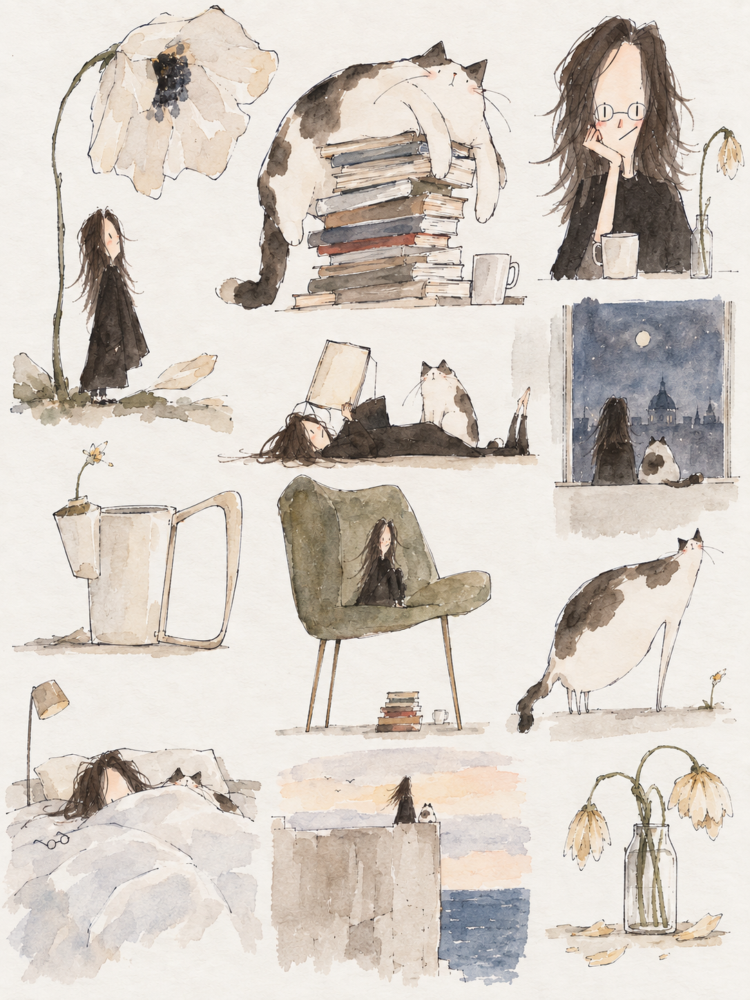

[English](README.md) | **中文**

# 沙冰 · Deadpan Doodles

<table>
  <tr>
    <td width="33%"></td>
    <td width="33%"></td>
    <td width="33%"></td>
  </tr>
</table>

上中学的时候，同桌喜欢画画。不管课间还是课上，经常把本子侧过来，拿我画水彩。

眼睛两道竖线，没鼻子，头发乱糟糟，颜色常洇出线外。画完推过来给我看，我说你画的这是什么玩意儿。

教室开着窗，风吹起半透明的纱帘，烈日照出空气中的灰尘。我偷偷地吃上节体育课带回来的袋装沙冰，沙冰化得很快，画纸上的颜色还湿着，它们叠在同一个盛夏里。

后来我们各奔东西，自然难再见她的丑画。而我阴差阳错的做了艺术，也开始画些七七八八的东西。每到天气热起来，就会鬼使神差的开始在自己的画上寻找那股洇开的色彩；可我的画通常太工整，像空调房，舒服却没有风。风是从歪掉的线条里进来的。有点不好意思，又不肯正经。

所以做了这个skill，在天气即将转凉时。它源于我的私心：想把那些个夏天，继续画丑一点。

## 画起来是什么样

- **像小孩子认真画出来的。** 大小和空间没分配周全，轮廓有几处笨拙的转折，主体却一本正经。
- **水色通透，偶尔洇出线外。** 薄色透出纸白，深色也留水分；笔线和颜色各自走，保留白隙、湿边与局部叠色。
- **比例反常，表情克制。** 大块体量、小小五官和细弱支撑形成反差，冷幽默从形状和事情里长出来。
- **不只画头像。** 人物、猫狗、花草、物件和小场景都可以；有背景、有细节，也可以保留童趣。

## 插画效果



三张头像和这张插画都是本项目的生成作品，用于展示沙冰的画面方向。展示图片不会自动成为每次生图都要附带的参考；默认风格基准和按需使用的猫样图见[资产索引](../../plugins/deadpan-doodles/skills/deadpan-doodles/references/style-assets.md)。

## 开始使用

通过 Codex CLI 从 LabArt 市场安装：

```sh
codex plugin marketplace add haorantang97/LabArt --ref main
codex plugin add deadpan-doodles@labart
```

需要宿主具备图像生成能力。本包提供指令、参考图和提示词组装器，不内置模型，也不配置 API Key。手动安装请保留[完整 skill 文件夹](../../plugins/deadpan-doodles/skills/deadpan-doodles)，不要只复制 SKILL.md。

也可以用 GitHub CLI 2.90 或更新版本单独安装 Skill：

```sh
gh skill install haorantang97/LabArt plugins/deadpan-doodles/skills/deadpan-doodles@main --agent codex
```

更新 gh 安装时，在同一命令后加 `--force` 重新安装。插件更新见[市场更新说明](../../README.md#marketplace)。
安装后开启新任务。介绍页、设计记录和开发测试留在仓库；运行配方与参考图随 Skill 安装。

附上照片，可以这样说：

> 用 $deadpan-doodles 把这张照片画成水彩人物。保留辨识特征，比例反常一点，表情一本正经，颜色自然洇出线外。

也可以直接描述一个小场景：

> 用 $deadpan-doodles 画一只瘫在一摞书上的猫，旁边是一杯茶。身体太大，爪子很小，认真地发呆。

头像有[专用模块](../../plugins/deadpan-doodles/skills/deadpan-doodles/references/portrait.md)处理辨识与人物比例；其他题材不套用固定额头、眼镜或长发。已经选中的图可只改点名部分。

## 包里有什么

[主 skill](../../plugins/deadpan-doodles/skills/deadpan-doodles/SKILL.md) · [固定配方](../../plugins/deadpan-doodles/skills/deadpan-doodles/STYLES.md) · [调用协议](../../plugins/deadpan-doodles/skills/deadpan-doodles/PROTOCOL.md) · [成图检查](../../plugins/deadpan-doodles/skills/deadpan-doodles/references/qa.md)

配方沿用沙冰通用版本 `shabing-20260925-1`。组装器记录实际提示词、参考顺序和文件校验值，不调用生图服务。同一份 skill 有助于保持方向，但不保证每次造型和水色完全一致。

公开调用名是 `$deadpan-doodles`；早期本地名 `deadpan-watercolor-ip` 不是另一个插件。结构检查和审美效果分别记录，详见[验证记录](VALIDATION.md)。

## 许可

[PolyForm Noncommercial 1.0.0](../../plugins/deadpan-doodles/LICENSE)。反馈时请只提交有权分享的图片、需求和实际提示词；修改介绍时同步维护中英文版本。

[返回 LabArt](../../README.md)
