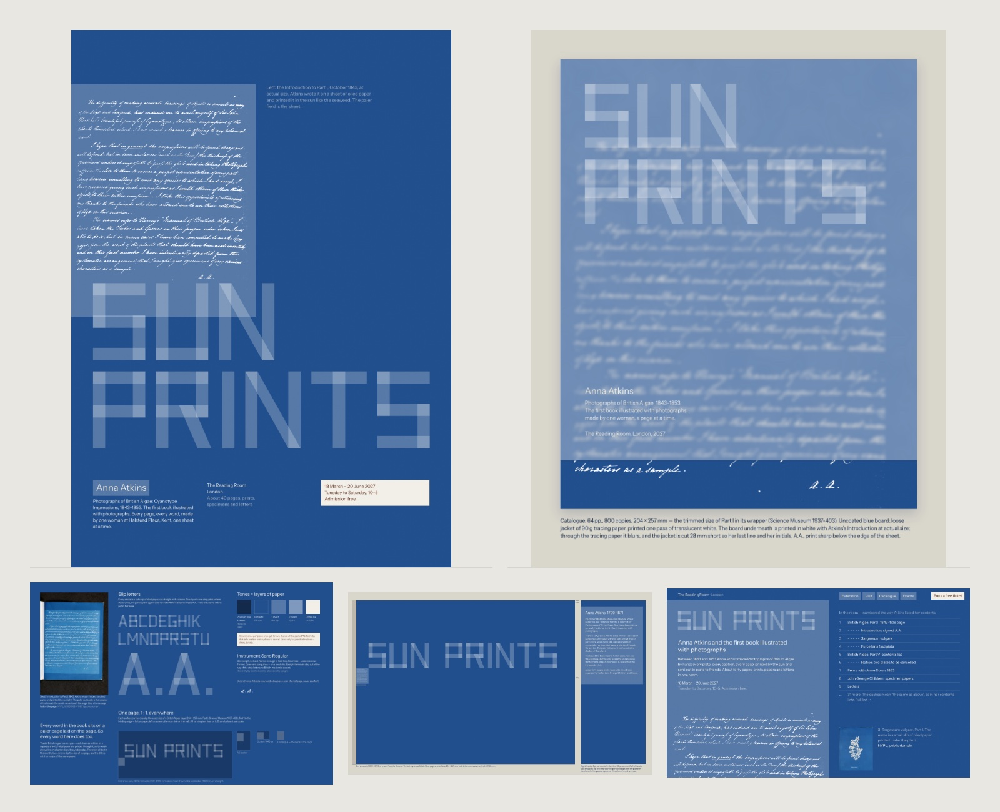
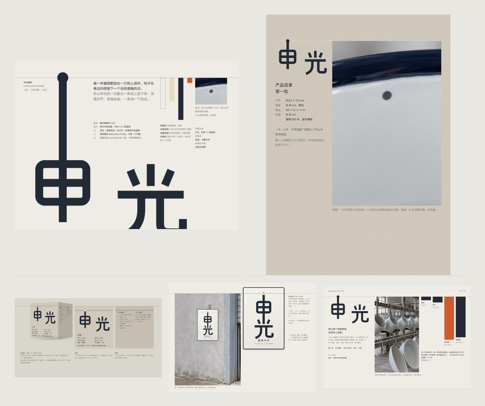

# Lab 平面设计 · Lab Graphic Design

[← LabArt](../../README.md) · [中文介绍](README.zh-CN.md)

Graphic identities for exhibitions, publishing, cultural institutions, and craft
brands, in a quiet, exact, material style. Every element has a reason: the letterform,
the grid, the colour, and the printing all trace back to one concrete fact about the
subject.

## How It Is Different

This is not a skill that imitates a look. It does not start from a look at all.

It starts from the brief, with nothing decided. It researches the subject for real:
its history, how it is made, where it lives, what it has printed before. It lists
many concrete facts and weighs several possible starting points before it commits to
one. From there, every decision has a reason you can ask for — why this letterform,
this colour, this paper, this size — and the answer always points back to something
true about the subject.

That is why two projects made with it look nothing alike, and why neither could be
swapped onto another client.

## The Style

- **Letters grown from the subject.** One detail you can point at — a strip of oiled
  paper, the hook a mug hangs from in the kiln — becomes a custom letterform.
- **One rule holds everything.** A single line or proportion taken from the same fact
  organises poster, wall, screen, and book.
- **Colour from materials.** Burnt clay, Prussian blue, cobalt glaze; one accent, used
  once per piece.
- **Print and material carry meaning.** Paper stock, tracing-paper jackets, punched
  holes, screen-printing straight onto walls, objects at actual size.
- **Quiet first, then more.** The first look is calm and holds; the second look finds
  the detail and where it came from. Hierarchy comes from position and scale, not bold.

## Examples

Both sets were made by the Skill from written briefs. The institutions and the brand
are fictional.

<table>
  <tr>
    <td width="50%">
      
      <br><strong>Anna Atkins: Sun Prints</strong><br>
      Every word in her 1843 cyanotype book was written on oiled paper and printed in
      sunlight, so it sits on a paler sheet. The letters are cut strips of that paper;
      where two strips cross, the tone steps up.
    </td>
    <td width="50%">
      
      <br><strong>申光搪瓷 · Shenguang Enamel</strong><br>
      Each enamel piece hangs on a hook in the kiln and keeps one small unglazed point.
      The stem of 申 ends in that point, and every layout hangs from one line.
    </td>
  </tr>
</table>

Cyanotype scans in the first set are public-domain NYPL images. Product and workshop
photographs in the second set are AI-generated stand-ins and are labelled as such
in the pieces.

## What Is Included

- `.codex-plugin/plugin.json`: Codex plugin metadata.
- `skills/lab-graphic-design/SKILL.md`: the working instructions, in Chinese.
- `skills/lab-graphic-design/agents/openai.yaml`: Codex UI metadata.
- `assets/examples/`: two selected outputs declared as plugin interface screenshots.
- `LICENSE`: the existing license, also included in the standalone Skill.

## Install As An Agent Skill

With GitHub CLI 2.90 or newer:

```bash
gh skill install haorantang97/LabArt plugins/lab-graphic-design/skills/lab-graphic-design@main --agent codex
```

The repository also supports the open `skills` installer:

```bash
npx skills add haorantang97/LabArt --skill lab-graphic-design
```

## Install In Codex

```bash
codex plugin marketplace add haorantang97/LabArt --ref main
codex plugin add lab-graphic-design@labart
```

Start a new Codex task after installation so the new skill is loaded.

## Example Requests

- Design an identity for a small museum: identity sheet, poster, sign, website, and book cover.
- Find one detail in this workshop's process and grow a wordmark from it.
- Review this identity: does every element have a reason, and does the first look stay quiet?

## Originality

Do not copy existing identities met during research or in references, and do not
present outputs as another studio's work.

## License

Distributed under the PolyForm Noncommercial License 1.0.0. See [LICENSE](../../LICENSE).
Package checks are described in [../VALIDATION.md](../VALIDATION.md).
