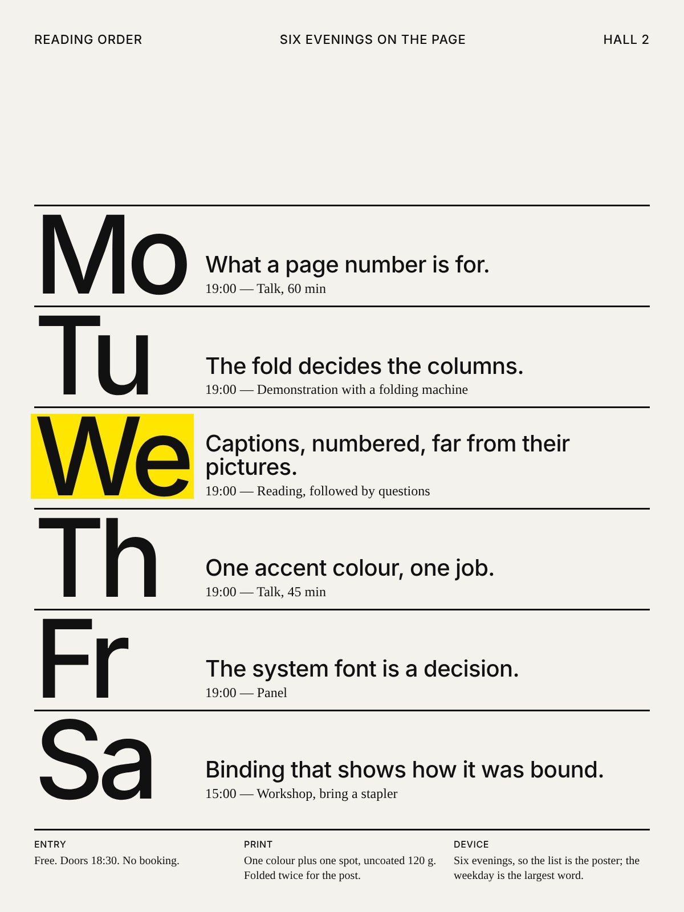
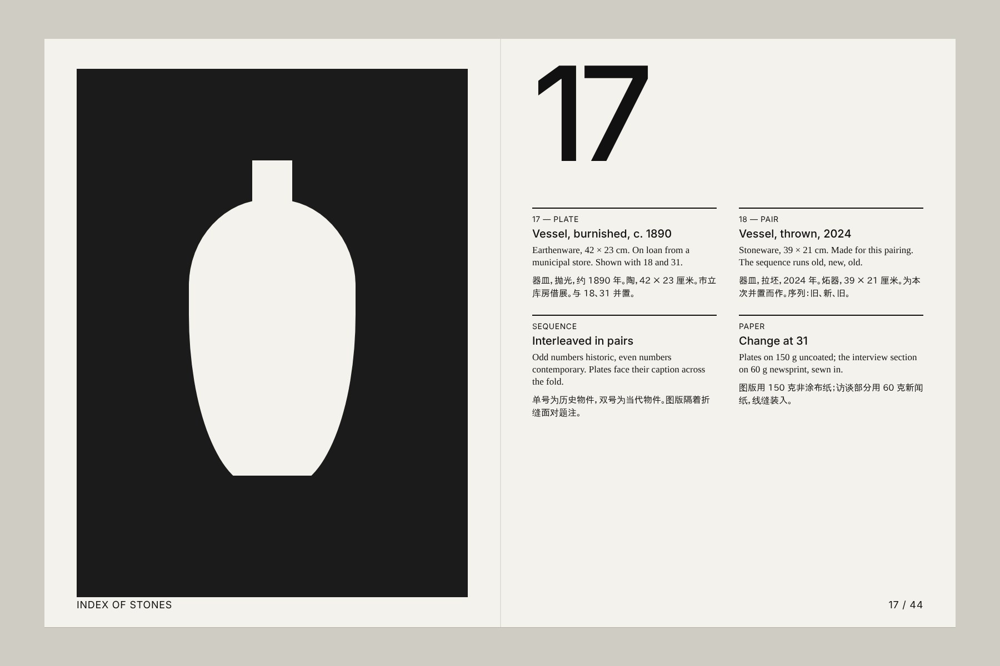
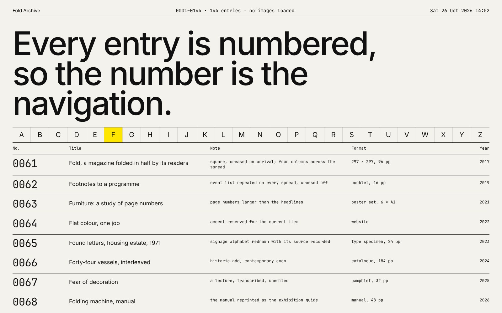
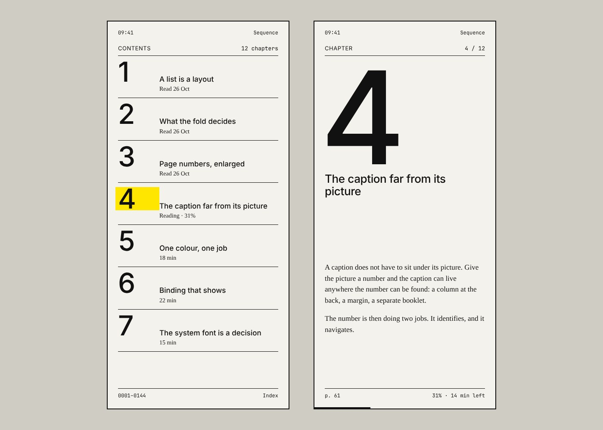

[English](README.md) | **中文**

# OK-RM Design · 有意义的秩序

<table>
  <tr>
    <td width="50%"></td>
    <td width="50%"></td>
  </tr>
  <tr>
    <td width="50%"></td>
    <td width="50%"></td>
  </tr>
</table>

一套平面与 UI 设计方法，蒸馏自对一家伦敦工作室公开作品与访谈的研究。一句话：
**从项目内容自身找出一个装置，用干燥、系统化的排印把它放大，用生产的经济性塑形，再把阅读排成序列。**
它是一种工作方式，不是风格库。包内不含该工作室任何作品图片，也不复制其任何版式；上面四张示例
都是用本方法制作的虚构项目。

## 五条法则

1. **结构来自内容。** 装置来自项目本身：名字的字面义、流程、工艺、物件、惯例、约束。不来自情绪板。
2. **一个装置，放大到底。** 找出关键点并夸张它。一个项目只有一个装置，其余退成系统。
3. **排印是骨干。** 中性 grotesk 作主语，文本衬线或等宽作第二声部。表现力来自极端的尺度对比和页面家具
   （页码、编号、题注、标点），不来自花字体。
4. **经济即形式。** 预算、纸张、折法、邮寄规格、印刷工艺、屏幕尺寸、系统字体都是生成器。每个限制都要留下可见决定。
5. **阅读是一个序列。** 书、网站、展览都是阅读顺序。交错、并置、尺度跳变、折出、换纸。让语境改变内容。

另有一条张力法则：干的字，湿的料。

## 包内内容

- [SKILL.md](../../plugins/okrm-design/skills/okrm-design/SKILL.md) 的七步工作流：列既有物、写装置陈述、定秩序、定经济、排序阅读、制作、验收。
- [秩序系统](../../plugins/okrm-design/skills/okrm-design/references/design-system.md)：字体、尺度阶梯、由折法派生的网格、家具、颜色、材料、图像、序列，以及按媒介的差异。
- [界面翻译](../../plugins/okrm-design/skills/okrm-design/references/ui-translation.md)：索引导航、表格列表、家具计数器、响应式即折法、干的状态与动效、作为秩序一部分的无障碍、HTML/CSS 骨架。
- [配方](../../plugins/okrm-design/skills/okrm-design/references/recipes.md)：装置陈述与规范模板、海报骨架、按媒介的图像模型提示词、修正表。
- [验收门槛](../../plugins/okrm-design/skills/okrm-design/references/qa.md)：三道主门（装置、经济、序列）、秩序门、界面门、立即失败项。
- `scripts/tokens.py`：从几个决定生成秩序表（CSS 自定义属性与 JSON），并按门槛检查任何秩序表：至多两个字体家族、三个量级的尺度、一个强调色、可读对比、由折法派生的栏数、45–75 字符行长。

## 开始

用 Codex CLI 从 LabArt marketplace 安装：

```sh
codex plugin marketplace add haorantang97/LabArt --ref main
codex plugin add okrm-design@labart
```

用 GitHub CLI 2.90 或更新版本安装独立 Skill：

```sh
gh skill install haorantang97/LabArt plugins/okrm-design/skills/okrm-design@main --agent codex
```

手动安装请复制[整个 skill 目录](../../plugins/okrm-design/skills/okrm-design)。token 脚本只需要 Python 3。安装后开启新任务。

试试：

> 用 $okrm-design 为一个六晚书籍设计讲座系列做海报与识别。先从简报里找装置。

> 用 $okrm-design 把这个藏品档案网站做成以编号为导航的排印界面，输出 tokens.css 和一页 HTML。

> 用 $okrm-design 把这本陶瓷目录排成阅读序列：历史与当代交错，换一次纸。

## 研究基础

方法蒸馏自关于 [OK-RM](https://www.ok-rm.co.uk/)（Oliver Knight 与 Rory McGrath 于 2008 年在伦敦创立的工作室）
的公开材料：设计媒体对其识别、书籍、杂志与展览图形的报道，访谈与讲座，书籍设计奖项评语，以及其 2024–2025 年
回顾展《A Meaningful Order》的公开文字（标题引自 Victor Papanek 对设计的定义）。代表性来源见
[英文页](README.md#study-basis)。

本包是独立研究，与该工作室无任何关联或授权，也不是其官方风格。使用本方法制作的作品，不得在提示词、署名或
宣传中使用该工作室或设计师的名字。

## 包内链接

[主 skill](../../plugins/okrm-design/skills/okrm-design/SKILL.md) · [秩序系统](../../plugins/okrm-design/skills/okrm-design/references/design-system.md) · [界面翻译](../../plugins/okrm-design/skills/okrm-design/references/ui-translation.md) · [配方](../../plugins/okrm-design/skills/okrm-design/references/recipes.md) · [门槛](../../plugins/okrm-design/skills/okrm-design/references/qa.md) · [研究笔记](../../plugins/okrm-design/skills/okrm-design/references/study-notes.md)

示例源文件在 [assets/okrm-design/examples](../../assets/okrm-design/examples)，用 `node scripts/render_okrm_examples.mjs` 渲染。
结构检查与示例验收记录在[验证说明](VALIDATION.md)。

## 许可

[PolyForm Noncommercial 1.0.0](../../plugins/okrm-design/LICENSE)。

[返回 LabArt](../../README.md)
