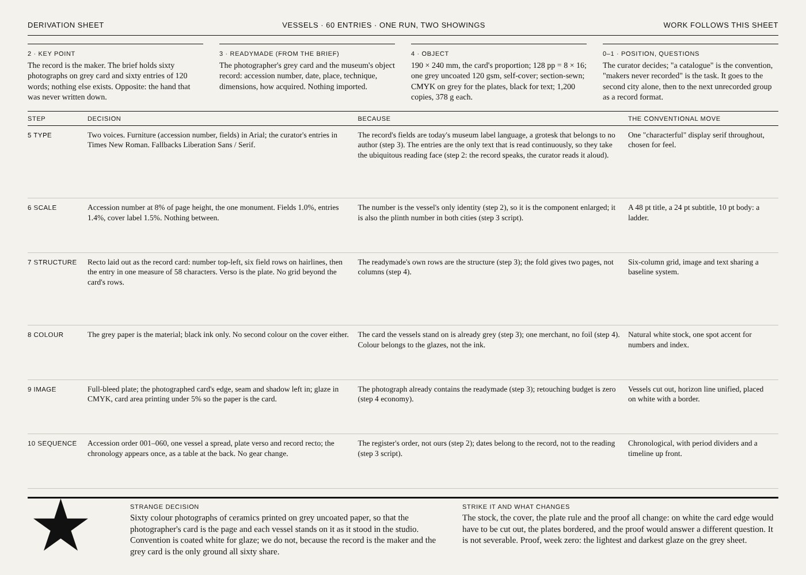

[English](README.md) | **中文**

# OK-RM Design · 有意义的秩序

<table>
  <tr>
    <td width="50%"></td>
    <td width="50%"></td>
  </tr>
  <tr>
    <td width="50%"></td>
    <td width="50%"></td>
  </tr>
</table>

一套平面与 UI 设计方法，蒸馏自对一家伦敦工作室公开作品、访谈与出版目录的研究。作品的灵魂在它怎样被想出来，
所以**每个视觉决定都要说得出它从哪里来**。产出是设计本身——封面、对页、海报、页面、界面——旁边放一份**推导文档**：
上游（定位、三问、关键点、从简报自身物件里取现成物的框架、版面之前的物件与经济），一条常规设计师会否决、却直接从内容
推出来的怪决定，再是一张推导表，字体、尺度、结构、颜色、图像、序列每行写成「决定 | 因为 | 常规做法」。
包内不含该工作室任何作品图片，也不复制其任何版式；示例都是用本方法制作的虚构项目。

## 一条推导链

| 步 | 问什么 | 推自 | 产出 |
| --- | --- | --- | --- |
| 0 定位 | 谁做决定；任务书里哪句是真任务、哪句只是惯例 | 任务书 | 定位备忘 |
| 1 三问 | 它是什么、为什么现在、去哪里；领域的既有系统与它们的疲劳 | 语境 | 三问＋语境阅读 |
| 2 关键点 | 直觉，再为直觉找理由；对立面 | 内容 | 关键点陈述 |
| 3 框架 | 舞台、演员、脚本；它「假装」是简报里的哪个现成物 | 简报里的物件 | 框架段落（代替情绪板） |
| 4 物件 | 版面之前的格式、装订、材料、印刷与经济，数字自洽 | 2、3、折法与预算 | 秩序表＋经济表 |
| ★ 怪决定 | 一条常规设计师会否决、却从 2 或 3 推出来的决定；划掉它物件要跟着变 | 2 或 3 | 一句话 |
| 5 字体 | 现成物本来用什么字；谁在说话（内容／家具）；衬线、无衬线、等宽各有且只有的理由 | 3 | 指名的字体与归属 |
| 6 尺度 | 哪件家具被放大到纪念碑级；其余在小的一极哪一档 | 2、3 | 五档尺度表 |
| 7 结构 | 现成物怎样分格；折法给几栏；对齐跟随什么 | 3、4 | 栏、对齐、三件家具、细线 |
| 8 颜色 | 材料本身什么颜色；要不要一个平涂颜色；它从哪件东西来 | 4 | 底、墨、平涂颜色及来源 |
| 9 图像 | 图像从哪来；在现成物里怎样出现；满版、图版还是小图 | 3、4 | 图像规则＋拍摄情境 |
| 10 序列 | 从哪进、按什么走、哪里换挡；界面的动作与索引 | 3 的脚本、4 的材料 | 序列草图（界面加页面清单） |
| 11 做出来 | HTML/CSS 页面、版式规范或 token 文件 | 5–10 | 作品 |
| 12 交接 | 方法（角色、单位、固定／变动）、生产（坚持、放弃、打样）、延续 | 全部 | 交接表 |

5–10 每行只有一种写法：「决定 | 因为（指回 2、3 或 4）| 常规做法」。写不出「因为」的决定是偏好，删掉。
字体怎么选——现成物本来用什么字、谁在说话、先用普遍语言、指名而不是「某某级」——见
[typography.md](../../plugins/okrm-design/skills/okrm-design/references/typography.md)。

34 个项目的生成路径记录在案例里：因为每平方毫米都是地产而竖折的季刊；因为展览讲手与机器而打孔的目录；把官僚程序
变成结构的回顾展；比它替换掉的 lookbook 更便宜的季度书；像已经被归档一样装订的目录；从自己的对话记录里长出来的
工作室之书。案例与来源的索引见 [CASES-INDEX.md](CASES-INDEX.md)。

## 链背后的八条原则

1. **内容与概念。** 设计是为内容建立框架。先直觉，再给直觉找理由，写下来。不做情绪板。
2. **找关键点并夸张。** 找出项目的关键点并夸张它。一个系统，放大它的一个组件。隐含变显性。
3. **表演性框架。** 比喻、剧场、脚本：舞台、演员、剧本。在既有系统里跳舞；没有约束就没有游戏。
4. **现成物与普遍语言。** 历史现成物（标牌字母、打孔卡、图书馆装订、邮票、磁带、信封、手册）与所有人共有的语言
   （系统 Helvetica、Times、Courier、条码、标签）。参考是被重演的，不是被借用外观的。
5. **经济即形式。** 最小值与约束；每平方毫米都是地产；一折多四页；封面无尺度；拼版思维——按它被折、切、装、
   再媒介化之后的样子来看一切。
6. **结构与游戏。** 一致的选择与流动的选择：标志不变，脸每期变；格式不变，图像每册变。
7. **对立的张力。** 把一物与其对立物并置：手与机、干字与湿料、几何与手绘、历史与当代。
8. **阅读序列。** DJ 需要舞者：节奏、预感、惊喜；交错的章节；对页的力量；不按年表。

另有机构工艺：靠近决策发生的地方；设计方法，而不是形式。

## 证据里的形式

在工作室公开发表的作品照片上叠 0.1 网格测量（精度约 ±1%）：

- 字在两极。书脊句、标签、题注约为封面高的 1.5%，正文约为页高的 1.2%；一个纪念碑级的词约为封面高的 10%、宽的 77%，
  单个字母标志可到 35–40%。中间的「大标题」几乎不存在。
- 声部：Helvetica 级 grotesk 配 Times 级衬线或打字机等宽，或只用一个家族。自制字体是对某一传统的重演。
  工作室自己的网站用 Helvetica/Arial、小字号的 Times 和系统等宽，字号用 vw。
- 标签居中并放宽字距；grotesk 的词在角落（边距 6%）；纪念碑级的词从左边开始，位于上三分之一。
- 封面图版白边约为宽的 10%，海报约 3%；布面上的小图约占封面宽的 40%。照片以黑白为主。
- 一个平涂颜色是材料：整张封面、环衬、标牌。字用黑或白。
- 材料来自装置：布面与亚麻脊条（占封面宽 9–14%）、羊皮纹纸、牛皮盒、铜板、和纸、马尼拉信封、PVC、橡皮筋、箔、
  盲压、贴纸、打孔、磁带、扑克牌。

## 包内内容

- [推导链上游](../../plugins/okrm-design/skills/okrm-design/references/genesis.md)：第 0–4 步与怪决定门（含可分离性检验）、交接步；
  [下游](../../plugins/okrm-design/skills/okrm-design/references/form-derivation.md)：第 5–11 步各问什么、推自哪里、常规做法长什么样，加推导表模板；
  [字体怎么选](../../plugins/okrm-design/skills/okrm-design/references/typography.md)：现成物与它本来的字的对照表、衬线／无衬线／等宽是「谁在说话」的问题、
  五问程序、按媒介指名的字体与回退栈、三个推导示例。
- [排列](../../plugins/okrm-design/skills/okrm-design/references/layout.md)：证据里反复出现的 14 个排列动作（不对称对页、散放、网格墙、堆叠拼贴、旋转、放开字距、
  被裁切的纪念碑、极大行距、密与空、表格即版面、条与板、成对、框与边、换纸），各写明何时成立；纪念碑不一定是数字。
- [材质与线条](../../plugins/okrm-design/skills/okrm-design/references/material-and-line.md)：材质动作、线条的五种身份（结构、图表、框、手、物理），
  以及物件视图怎样读得出是物件。
- 有生图工具或本地 bridge 时，见 [recipes.md](../../plugins/okrm-design/skills/okrm-design/references/recipes.md) 第 5a 节：模型出资产，字留在 HTML。
- [案例](../../plugins/okrm-design/skills/okrm-design/references/cases.md)：34 个按类型与年份记录的项目路径，每个以常规设计师会否决的那个决定收尾。
- [偏离算子](../../plugins/okrm-design/skills/okrm-design/references/deviation-operators.md)：从这些决定归纳的操作，按改格式、换现成物、改序列、改语境、改界面分组，附条件与迁移示例。
- [秩序系统](../../plugins/okrm-design/skills/okrm-design/references/design-system.md)：装置来源、框架、带证据的声部表、
  带实测的尺度两极、对齐、结构、家具、作为材料的颜色、图像、材料、拼版、序列，以及按媒介的差异。
- [界面翻译](../../plugins/okrm-design/skills/okrm-design/references/ui-translation.md)：隐含变显性（动作用括号写出、
  计数器做家具）、索引导航、表格列表、整屏换色即换纸、响应式即折法、干的状态与动效、无障碍、HTML/CSS 骨架。
- [配方](../../plugins/okrm-design/skills/okrm-design/references/recipes.md)：装置与框架模板、规范模板、封面骨架、
  按媒介的图像模型提示词、修正表。
- [验收门槛](../../plugins/okrm-design/skills/okrm-design/references/qa.md)：主门验上游（完整、一条推得回内容且不可分离的怪决定、物件先于版面且数字自洽、
  现成物来自简报），推导门验形（每行有「因为」和常规做法、字体指名并有归属、尺度两极、结构与颜色来自现成物与材料），作品门（渲染了、与表对得上、交接表齐），
  界面门与立即失败项。
- `scripts/tokens.py`：生成秩序表（CSS 变量与 JSON），并按门槛检查：至多两个声部、尺度两极且中间为空、一个作为材料的颜色、
  可读对比、折法派生的栏数、45–75 字符行长。

## 开始

```sh
codex plugin marketplace add haorantang97/LabArt --ref main
codex plugin add okrm-design@labart
```

```sh
gh skill install haorantang97/LabArt plugins/okrm-design/skills/okrm-design@main --agent codex
```

手动安装请复制[整个 skill 目录](../../plugins/okrm-design/skills/okrm-design)。token 脚本只需要 Python 3。安装后开启新任务。

试试：

> 用 $okrm-design 从零开始做这个项目并做出来：先写上游（定位、三问、关键点、框架、物件）和一条怪决定，再推导字体、尺度、结构、颜色、图像、序列，每行写「因为」，最后渲染页面。

> 用 $okrm-design 把这个藏品档案网站做成编号即导航、动作用括号写出的排印界面，输出 tokens.css 和一页 HTML。

> 用 $okrm-design 把这本季刊做成折叠格式：标志固定，封面随每期的「情绪」变化。

## 研究基础

方法蒸馏自关于 [OK-RM](https://www.ok-rm.co.uk/)（Oliver Knight 与 Rory McGrath 于 2008 年在伦敦创立）的公开材料，
一手来源均已通读：工作室自述与回顾展新闻稿、出版品牌 41 条产品规格、2010–2026 年间 12 篇访谈与对谈、约 20 篇项目报道与评论、
字体使用档案 7 条、官网 31 张作品照片的网格测量以及官网自身的 CSS。完整来源清单见[英文页](README.md#study-basis)。

本包是独立研究，与该工作室无任何关联或授权，也不是其官方风格。使用本方法制作的作品，不得在提示词、署名或宣传中使用
该工作室或设计师的名字。

## 包内链接

[主 skill](../../plugins/okrm-design/skills/okrm-design/SKILL.md) · [秩序系统](../../plugins/okrm-design/skills/okrm-design/references/design-system.md) · [界面翻译](../../plugins/okrm-design/skills/okrm-design/references/ui-translation.md) · [配方](../../plugins/okrm-design/skills/okrm-design/references/recipes.md) · [门槛](../../plugins/okrm-design/skills/okrm-design/references/qa.md) · [研究笔记](../../plugins/okrm-design/skills/okrm-design/references/study-notes.md)

示例源文件在 [assets/okrm-design/examples](../../assets/okrm-design/examples)，用 `node scripts/render_okrm_examples.mjs` 渲染。
结构检查与示例验收记录在[验证说明](VALIDATION.md)。

## 许可

[PolyForm Noncommercial 1.0.0](../../plugins/okrm-design/LICENSE)。

[返回 LabArt](../../README.md)
