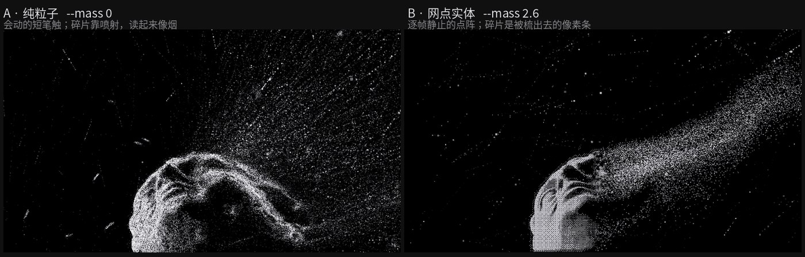
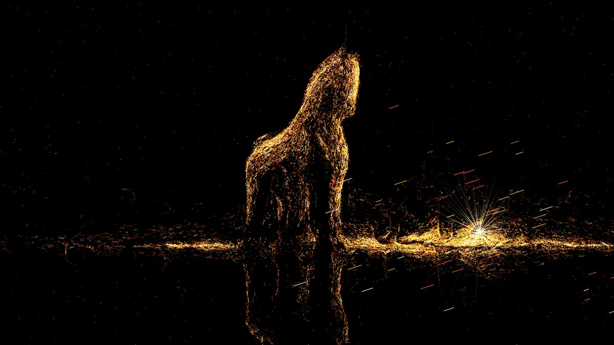
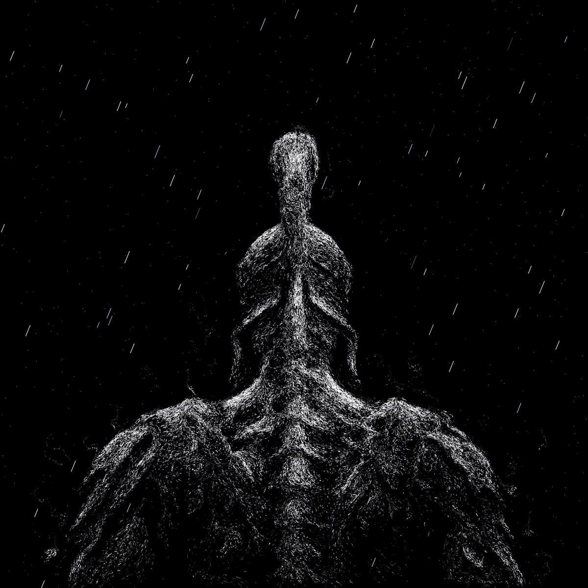
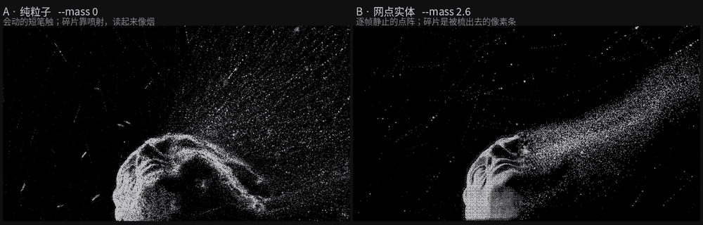

# Tephra

[← LabArt](../../README.md)

Tephra is a deterministic renderer that redraws any image as black-background
pixel art, in one of two canonical modes chosen by subject. **Pure particle**:
short strokes follow the image's own structural direction field and really travel
along it — right for waves, smoke, light shafts, anything already in motion.
**Dithered solid**: the image's tone becomes an ordered dither that stays perfectly
still frame to frame, and can be combed along a direction into hard-edged fracture
streaks — right for figures, sculpture, animals, architecture, where contour and
volume have to read. Regional motion is planned from the picture's physics (light
falls, embers rise, wave barrels rotate), and every animation loops seamlessly.
Outputs PNG, GIF and MP4.

No model runs at render time. The renderer is numpy and Pillow; the same command
and the same seed produce the same file, byte for byte. What a language model
contributed is the algorithm itself — the reference material was measured rather
than imitated, and those measurements became parameters. The work here is the
command, not the image. The image can always be rendered again.



*The same subject rendered both ways — pure particle left, dithered solid right
(animated: `assets/examples/canon-modes.gif`).*

## Examples

<table>
  <tr>
    <td width="50%">
      
      <br><strong>Single light source</strong><br>
      The eye is the burst focus; dust streams away from it and the pillar falls.
    </td>
    <td width="50%">
      
      <br><strong>Physics-planned motion</strong><br>
      The shaft falls, the back of the wave climbs, the barrel rotates.
    </td>
  </tr>
  <tr>
    <td width="50%">
      
      <br><strong>Structure-following strokes</strong><br>
      Every plank reads because strokes lie along the image's own edges.
    </td>
    <td width="50%">
      
      <br><strong>Long/short stroke mix</strong><br>
      Specks carry the form; frayed streaks carry the energy.
    </td>
  </tr>
</table>

## Animated examples




## Install

Install the plugin from the LabArt marketplace:

```sh
codex plugin marketplace add haorantang97/LabArt --ref main
codex plugin add tephra@labart
```

Or install the standalone Skill with GitHub CLI 2.90 or newer:

```sh
gh skill install haorantang97/LabArt plugins/tephra/skills/tephra@main --agent codex
```

For manual installation, copy the [complete Skill directory](../../plugins/tephra/skills/tephra)
into the host's Skill directory. It includes scripts, measurement references, the
mode-selection image, metadata, and license. Install Python with NumPy and Pillow
for rendering; MP4 export also requires FFmpeg. Start a new task after installation.
Re-run the same `gh skill install` command with `--force` to refresh a gh installation;
see the [marketplace update instructions](../../README.md#marketplace) for plugin updates.

## Workflow and parameters

See the [skill guide](../../plugins/tephra/skills/tephra/SKILL.md) for mode selection, rendering commands, and output checks, and the [worked example](../../plugins/tephra/skills/tephra/references/worked-example.md) for a complete walkthrough.

## License

[PolyForm Noncommercial 1.0.0](../../LICENSE).
