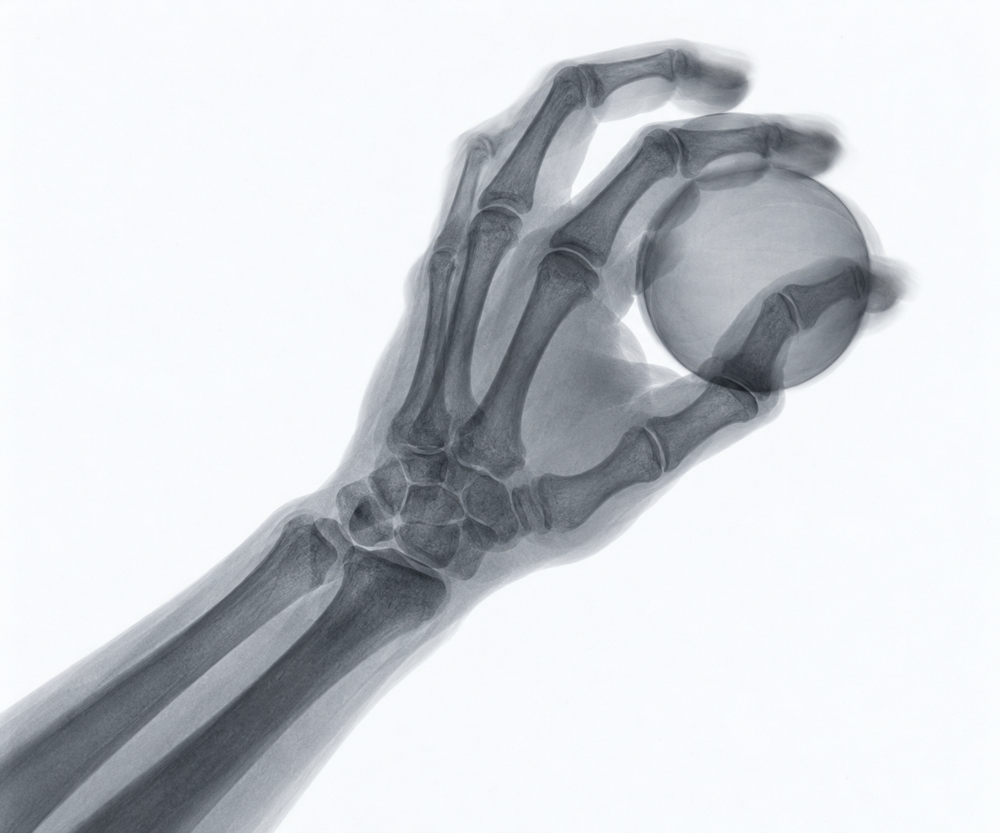
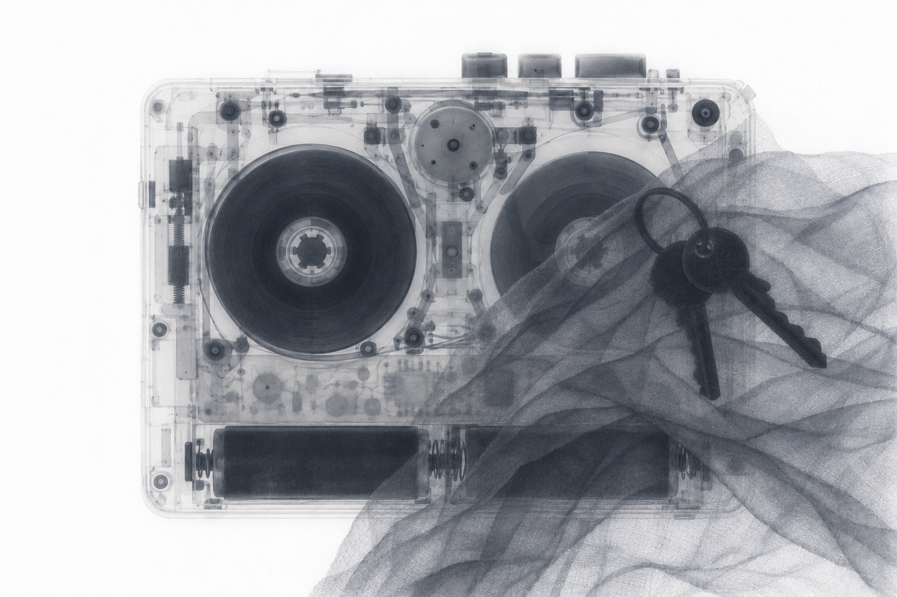
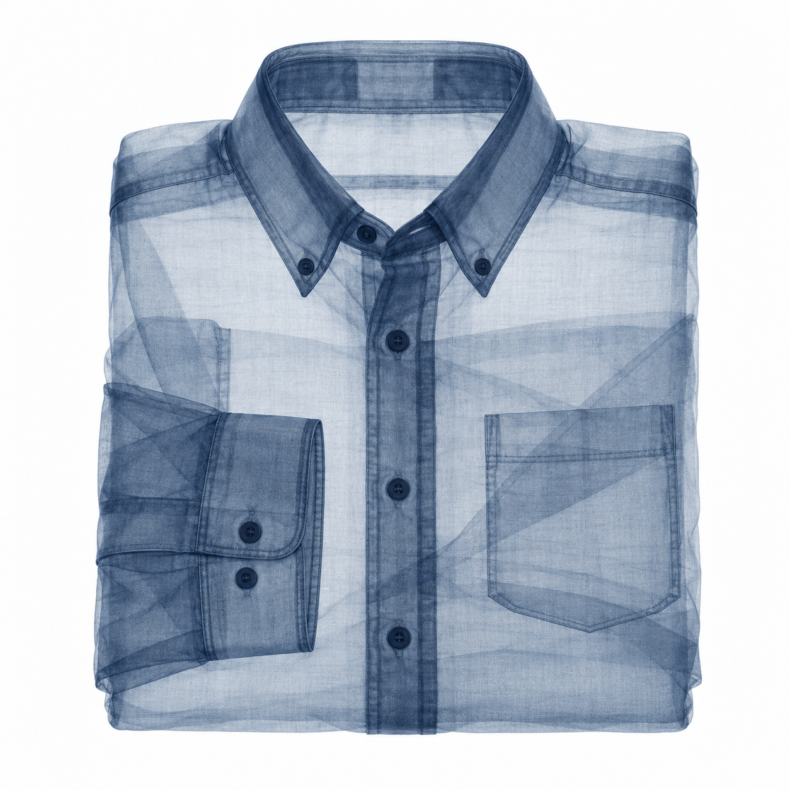
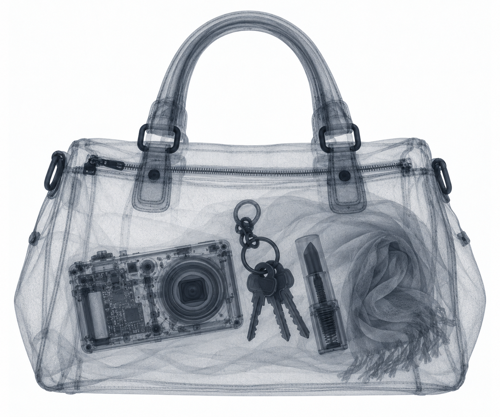

# X-ray

[← LabArt](../../README.md) · [中文介绍](README.zh-CN.md)

See external form and internal construction together. X-ray creates original
radiographic images through layered density, material contrast, and restrained
transmission detail. It can explore objects, folded textiles, living gestures,
and interactions between people and machines.

## Examples

Four selected AI-generated outputs from development. They illustrate the visual
direction, not physical simulation or verified anatomy.

<table>
  <tr>
    <td width="50%"> <strong>Hand and ball</strong> Articulated joints, contact, and a faint soft-tissue envelope.</td>
    <td width="50%"> <strong>Player and keys</strong> Dense hardware, folded fabric, and overlapping circuitry.</td>
  </tr>
  <tr>
    <td width="50%"> <strong>Folded shirt</strong> Collars, cuffs, seams, and folds accumulate into layered density.</td>
    <td width="50%"> <strong>Handbag, front view</strong> An intact silhouette reveals fastenings and contents together.</td>
  </tr>
</table>

## The Visual System

- **Density carries form.** Thin layers remain faint; thicker paths and overlaps
  accumulate; dense parts can conceal what is behind them.
- **One projection, one display.** Keep view, material response, and polarity
  coherent across the scene.
- **Actions have contacts.** Check joints, grips, pedals, and tools rather than
  letting blur or a dramatic pose conceal structure.
- **References have roles.** Separate a real radiograph, a generated appearance
  anchor, a source subject, and a presentation example.

## What Is Included

- Plugin manifest, license, and four declared interface screenshots.
- A standalone Skill with SKILL.md, Codex UI metadata, and its own license.
- Formation, prompting, and qualitative acceptance references.
- Two explicitly generated runtime appearance anchors: shirt and player.
- [Validation notes](VALIDATION.md) recording actual tests and unresolved limits.

The plugin uses an available raster generator/editor. It does not bundle a model,
require an API key, or install research repositories. A suitable renderer is
needed for actual images; without one, the workflow provides prompts and review
criteria. The images are synthetic visual art, not diagnostic scans. Anatomy,
engineering correctness, and general generation stability have not been established.

## Install As An Agent Skill

With GitHub CLI 2.90 or newer:

~~~bash
gh skill install haorantang97/LabArt plugins/x-ray/skills/x-ray@main --agent codex
~~~

Or use the open skills installer:

~~~bash
npx skills add haorantang97/LabArt --skill x-ray
~~~

## Install In Codex

~~~bash
codex plugin marketplace add haorantang97/LabArt --ref main
codex plugin add x-ray@labart
~~~

Start a new task after installation so the skill is loaded.

## Example Requests

- Create a pale-field X-ray image of a folded jacket, showing seams and layers.
- Render a hand interacting with a simple object; check the joints and contact.
- Keep this radiographic reference consistent while adding a dense metal overlap.
- Build an action scene with a rider and bicycle, then inspect each contact.

## License

Distributed under the PolyForm Noncommercial License 1.0.0. See
[LICENSE](../../LICENSE). Package checks are described in
[../VALIDATION.md](../VALIDATION.md).
