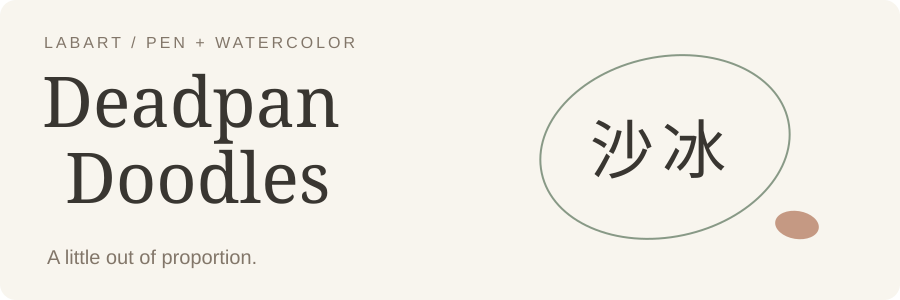

<picture>
  <source media="(prefers-color-scheme: dark)" srcset="assets/hero-dark.svg">
  
</picture>

**English** | [中文](README.zh-CN.md)

# Deadpan Doodles · 沙冰

A little wrong in proportion. Completely serious about it.

Create translucent pen-and-watercolor illustrations of people, animals, plants,
objects, and small scenes. Keep one memorable proportion contrast, loose lines,
and plenty of paper showing through the color. Not limited to avatars.

## Start

Install from the LabArt marketplace using the Codex CLI:

```sh
codex plugin marketplace add haorantang97/LabArt
codex plugin add deadpan-doodles@labart
```

An image-generation-capable host is required; this package does not bundle a model
or configure API keys. It does not lock a particular model. For manual skill
installation, keep the **whole** [skill folder](skills/deadpan-doodles), including
references and images, rather than copying SKILL.md alone.

Try:

> Use $deadpan-doodles to draw a languid cat beside a small flower. Translucent
> watercolor, a little strange in proportion, quietly funny rather than cute.

For a recognizable personal character, attach a photo:

> Use $deadpan-doodles to turn this photo into a deadpan watercolor character.
> Preserve my recognizable features, but make the proportions playfully unusual.

## What stays consistent

| Layer | Its job |
|---|---|
| Material | Thin transparent washes, local darker overlaps, exposed paper, loose fine pen lines |
| Proportions | A subject-specific size or spacing contrast; noticeable, but not everything exaggerated |
| Subject | The requested person, animal, plant, object, or small event—not the person in the material reference |
| Portrait module | Photo likeness, shorthand facial features, paired eyes, and bounded character edits |

A cat may have a slightly too-long body and tucked short legs. A flower may seem a
little heavy for its thin stem. These are possibilities, not mandatory templates.
The character stays calm; the shape carries the joke.

The design borrows a principle from the sibling [Antibes Holiday](../antibes-holiday/README.md):
give imbalance a purpose and let the rest remain quiet. Here that principle acts
primarily **inside the subject's proportions**, not through a required composition.
The watercolor medium remains independent.

## Included visual references

<table>
  <tr>
    <td width="50%"></td>
    <td width="50%"></td>
  </tr>
</table>

Both are generated portrait samples from this project. They demonstrate material;
neither is a universal body or face template. The second sample's large forehead
is not a default instruction. No original artist reference images, source
photographs, or crops from those works are bundled.

The [material index](skills/deadpan-doodles/references/style-assets.md) points to
regions inside these complete images. It is not a set of brush presets or a
separately generated swatch sheet. Non-human requests use the material behavior,
not the faces, hair, glasses, palette, or clothing.

## Portraits are a module, not the whole skill

The [main skill](skills/deadpan-doodles/SKILL.md) handles common visual decisions.
The [portrait module](skills/deadpan-doodles/references/portrait.md) loads only for
photo likeness or character work. It preserves the more-tested portrait workflow
without prescribing forehead height or fixed feature coordinates to everything.

For a selected image, request a local change such as:

> Keep this drawing's watercolor, hair, and small body. Shorten the face a little,
> but keep its offbeat shape and the naturally paired eyes.

The selected image becomes the edit target. Changes are not promised to be
pixel-identical outside the edited area.

## Limits and validation

This is a reusable instruction-and-reference package, not a deterministic
renderer. Identity and style can drift. A fixed prompt alone does not guarantee
the same character. Portraits have received more iteration than other subjects;
broader scope is not a claim of equal reliability.

New generations remain candidates until accepted. Failed tests are retained,
not silently replaced or promoted into the reference library.
See [validation notes](VALIDATION.md) for the actual checks and remaining tests.

The public invocation is `$deadpan-doodles`. The earlier local name
`deadpan-watercolor-ip` is not a second public plugin.

## Contribute and license

When reporting a result, include the request, actual prompt, input-image roles,
and first output when you have permission to share it. Do not submit private
photographs or third-party reference artworks. Keep both README editions aligned.

Package license: [PolyForm Noncommercial 1.0.0](LICENSE).
The package license is not a guarantee about rights in generated outputs or
input images; those depend on the inputs and the image service used.

[Back to LabArt](../../README.md)
